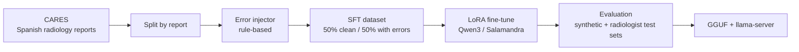

<h1 align="center"></h1>

A small, local LLM that reviews **Spanish radiology reports** before they are signed and flags internal inconsistencies: swapped laterality, inverted negations, implausible measurements, and findings missing from the conclusion. Think of it as a linter for radiology reports.

> **Status:** research preview, **not validated by a physician**. Learning project, not a medical device, not for clinical use. It only checks the internal consistency of a text; it never judges whether a finding is clinically correct.

## Why

Radiologists dictate reports with speech recognition, and small errors slip through ("derecho" vs "izquierdo", "no se observa" vs "se observa"). Hospitals cannot send real reports to hosted LLM APIs, so a useful checker has to be **small enough to run on-premises**. Prior work (Sun et al., *Radiology* 2025) showed that fine-tuned open models trained on synthetic errors can beat GPT-4 at this task, in English. radcheck explores the same idea in Spanish with small models.

## How it works



Input: the text of a report. Output: JSON listing the problems found (or an empty list).

```json
{"errores": [{"tipo": "lateralidad", "fragmento": "derrame pleural izquierdo",
  "explicacion": "Los hallazgos describen el derrame en el lado derecho."}]}
```

## Quick start

```bash
# AMD GPU (ROCm 7.2)
uv sync --extra rocm --group dev
# NVIDIA GPU (CUDA 13.0, incl. Blackwell)
uv sync --extra cuda --group dev

uv run --extra rocm python -c "import torch; print(torch.__version__, torch.cuda.is_available())"
```

Pass the extra to **every** `uv sync` and `uv run`. A bare `uv run` re-syncs the environment without the extra and silently swaps in the default PyPI (CUDA) build of torch. See [Development](./docs/development.md#the-extra-trap).

## Model

Public research preview on Hugging Face ([collection](https://huggingface.co/collections/Crstian19/radcheck-6ae5ae4780732cb99bf9bfa3)), CC BY-NC-SA 4.0 (inherited from CARES). Each repo holds one model family; every training recipe is a commit + git tag (`v1`, `v2`, ...), `main` is the latest, and `revision="v4"` loads an older one. Uploaded with `python -m radcheck.publish`.

The current version, v4.1, averages the LoRA adapters of several training seeds (a model soup). Scores on RadCheck-Bench-ES (F1) and on the extra track (60 reports: missing findings and dictation slips):

| Repo | What | Bench F1 | Extra F1 |
|---|---|---|---|
| [radcheck-qwen35-4b-lora-es](https://huggingface.co/Crstian19/radcheck-qwen35-4b-lora-es) | LoRA for Qwen3.5-4B | 0.956 | 0.500 |
| [radcheck-qwen35-4b-gguf-es](https://huggingface.co/Crstian19/radcheck-qwen35-4b-gguf-es) | Merged 4B, Q8_0 / Q4_K_M for llama.cpp | 0.956 / 0.953 | |
| [radcheck-qwen35-9b-lora-es](https://huggingface.co/Crstian19/radcheck-qwen35-9b-lora-es) | LoRA for Qwen3.5-9B | 0.956 | 0.535 |
| [radcheck-qwen35-9b-gguf-es](https://huggingface.co/Crstian19/radcheck-qwen35-9b-gguf-es) | Merged 9B, Q8_0 / Q4_K_M for llama.cpp | 0.959 / 0.944 | 0.552 / 0.494 |

Benchmark: [radcheck-bench-es](https://huggingface.co/datasets/Crstian19/radcheck-bench-es) (synthetic reports, no patient data, CC BY 4.0).


## Documentation

| Doc | Content |
|---|---|
| [Architecture](./docs/architecture.md) | Task definition, error taxonomy, data pipeline, models, metrics |
| [Data](./docs/data.md) | Datasets, licences, and the rules about patient data |
| [Development](./docs/development.md) | Environment on AMD (ROCm) and NVIDIA (CUDA), commands, layout |
| [Benchmark spec](./docs/benchmark-spec.md) | RadCheck-Bench-ES: independent evaluation set, brief for the agent that builds it |

## Licence

Code: [MIT](./LICENSE). Data and any model trained on CARES inherit **CC BY-NC-SA 4.0** (non-commercial, share-alike). See [docs/data.md](./docs/data.md).
