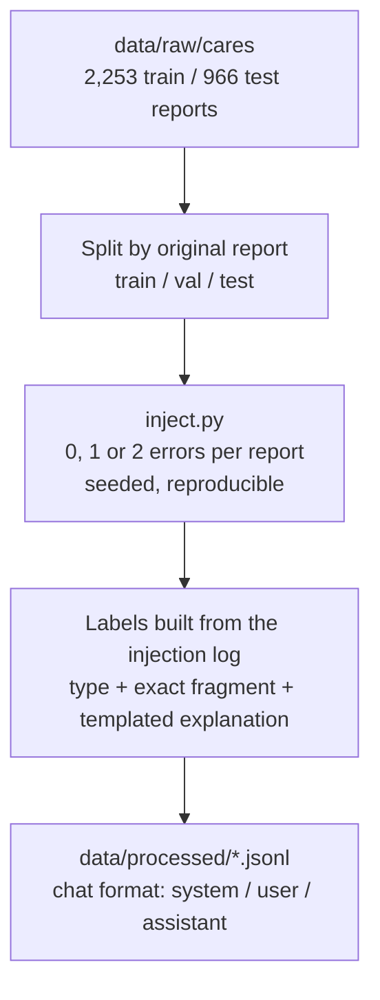

# Architecture

This document describes what radcheck does, how the training data is built, which models are compared, and how results are measured. It is the reference for anyone (human or LLM) working on the code.

## Task

Given the free text of a Spanish radiology report, return a JSON object listing internal inconsistencies:

```json
{
  "errores": [
    {"tipo": "<error type>", "fragmento": "<exact span from the report>", "explicacion": "<one sentence, Spanish>"}
  ]
}
```

An empty list means "no problems found". Clean reports are half of the training data, because false alarms are the main failure mode of this kind of tool (a GPT-4 proofreading study on real head CT reports reported a positive predictive value of 0.05).

**Out of scope:** clinical correctness, images, diagnosis suggestions, severity.

## Error taxonomy

**Injection rule:** an error is only injected when it creates an inconsistency that can be verified from the text itself, between the findings (`HALLAZGOS`) and the conclusion (`CONCLUSION`, `IMPRESIÓN`...). Swapping the side of a finding mentioned only once is undetectable even for a radiologist; training on it would teach the model to guess.

| `tipo` | Example | Eligibility (implemented in `src/radcheck/inject.py`) |
|---|---|---|
| `lateralidad` | "riñón izquierdo" in findings, "riñón derecho" in conclusion | A side word in one section whose preceding anatomical word appears with the same side in the other section |
| `negacion` | "No se observan adenopatías" vs "Se observan adenopatías" | A negation whose content words appear in a negated sentence of the other section. Flips `no se observa(n)`, `no hay`, `no apreciamos`..., `sin signos/evidencia/datos de` |
| `medida` | 18 mm in findings, 180 mm or 18 cm in conclusion | The same number + unit appears in both sections; one is scaled ×10 or has its unit swapped |

Deferred until the radiologist reviews the taxonomy: `discordancia` (finding missing from the conclusion) and `transcripcion` (speech-recognition confusions).

### Coverage on CARES train (2,253 reports)

| Property | Share |
|---|---|
| Has a conclusion section | 97% |
| Eligible for at least one error | 42% |
| `lateralidad` / `negacion` / `medida` eligible | 30% / 12% / 6% |

## Data pipeline



Rules:

- **Split before injecting.** Several variants are generated from each report; all of them must stay in the same split, otherwise test scores leak.
- Injection is deterministic given a seed; the dataset version is the injector commit + seed.
- Up to 3 corrupted variants per eligible report. Clean examples are then sampled from **all** reports to reach 50%, so "no injectable pattern" is not a shortcut for "clean".
- `fragmento` is always an exact substring of the corrupted report, so evaluation can locate it.

Build it with `uv run --extra rocm python -m radcheck.dataset` (stats go to `data/processed/stats.json`). Seed 13 gives:

| Split | Reports | Examples | Clean | lateralidad | negacion | medida |
|---|---|---|---|---|---|---|
| train | 2,026 | 3,454 | 1,727 | 1,103 | 393 | 231 |
| val | 227 | 378 | 189 | 118 | 49 | 22 |
| test | 966 | 1,626 | 813 | 551 | 176 | 86 |

Known imbalance: `lateralidad` is 64% of the errors because it is the most frequently eligible type.

### Recipe v2 (hard negatives)

`python -m radcheck.dataset --recipe v2 --out data/processed-v2` (default `--hard-clean-share 0.8`). Two changes, both aimed at the false alarms seen in v1:

- **At most one variant per eligible error type per report** (v1 drew up to 3 random variants, mostly `lateralidad`).
- **Clean examples are drawn first from reports that mention both sides** ("derecho" and "izquierdo" for different findings). Every `lateralidad` error mentions both sides by construction, so in v1 "both sides appear" was a shortcut for "error".

| Train set | Examples | Clean | Clean mentioning both sides | P(error \| both sides appear) |
|---|---|---|---|---|
| v1 | 3,454 | 1,727 | 654 | 0.67 |
| v2 | 1,966 | 983 | 748 (all available in CARES train) | **0.51** |

v2 is smaller; the test set stays v1 (`data/processed-v2/test.jsonl` is a copy of `data/processed/test.jsonl`) so every model is compared on the same examples.
- Explanations are templated, not LLM-generated, so labels are exact and licence-clean.
- CARES reports may contain genuine original errors. Flags on "clean" reports are reviewed, not automatically counted as false positives.

## Evaluation sets

| Set | Measures | Source |
|---|---|---|
| Synthetic test | Recall/precision per error type | CARES test split + injector |
| Clean test | False alarm rate | CARES test split, untouched |
| Radiologist test | Real-world-like errors without injector artefacts | ~100 reports written from scratch by the collaborating radiologist |

The radiologist set is the headline result and is never used for training.

## Metrics

| Metric | Definition | Target (indicative) |
|---|---|---|
| Recall per type | Injected errors detected (span overlap) / injected errors | > 0.8 synthetic |
| Precision | Correct flags / all flags | > 0.8 |
| False alarm rate | Clean reports with ≥1 flag / clean reports | < 0.05 |
| Valid JSON | Parseable outputs / outputs | ≈ 1.0 |
| Detection rate | Corrupted reports with ≥1 flag / corrupted reports | — |

A prediction matches a gold error when the `tipo` is the same and its `fragmento`, located in the report (case and whitespace tolerant), overlaps the injected span **or its counterpart** (the mention in the other section that the change now contradicts: from the text alone either side of a contradiction may be the wrong one); if it cannot be located, it matches when it contains the changed text. Unmatched predictions are false positives; invalid JSON counts as "no prediction". Implemented in `src/radcheck/metrics.py`. After a metric or gold change, saved predictions can be re-scored without re-running the model: `python -m radcheck.evaluate --rescore outputs/eval/<run>.json --data data/processed/test.jsonl`.

## Results

200 random test examples (seed 0), same prompt, greedy decoding, scored with the counterpart-aware metric.

| Model | F1 | Precision | Recall | F1 lat / neg / med | False alarms | Invalid JSON |
|---|---|---|---|---|---|---|
| Qwen3-0.6B, prompt only | 0.11 | 0.08 | 0.19 | 0.16 / 0.08 / 0.00 | 59% | 5.5% |
| Qwen3-0.6B + LoRA r16, 1 epoch (57 min on RX 6800) | 0.69 | 0.71 | 0.68 | 0.71 / 0.61 / 0.71 | 12% | 0% |
| Qwen3-4B + LoRA r16, 1 epoch (11 min on RTX PRO 6000 Max-Q, batch 4×4, no grad checkpointing) | **0.91** | 0.92 | 0.90 | 0.93 / 0.81 / 0.95 | **2%** | 0% |

Validation loss at the end of the epoch: 0.092 (0.6B) vs 0.066 (4B). Missing for a fair comparison: Qwen3-4B prompt-only baseline and the Qwen3-32B prompt-only reference.

### Full injector test set (1,626 examples, half clean)

LoRA r16, 1 epoch, trained on the RTX PRO 6000 Blackwell. `v2` = training recipe with hard negatives.

| Model | F1 | Precision | Recall | F1 lat / neg / med | False alarms | Detection |
|---|---|---|---|---|---|---|
| Qwen3.5-4B (v1) | 0.920 | 0.931 | 0.910 | 0.925 / 0.911 / 0.909 | 2.7% | 95.1% |
| Qwen3.5-4B (v2) | 0.907 | 0.926 | 0.889 | 0.910 / 0.897 / 0.909 | 2.5% | 93.6% |
| Qwen3.5-9B (v1) | 0.920 | 0.925 | 0.915 | 0.923 / 0.895 / 0.958 | 3.3% | 95.6% |
| Qwen3.6-35B-A3B (v1) | 0.918 | 0.920 | 0.916 | 0.922 / 0.901 / 0.929 | 3.9% | 95.7% |
| Qwen3.8-27B (v1) | 0.948 | 0.945 | 0.951 | 0.955 / 0.930 / 0.942 | 3.2% | 97.4% |
| **Qwen3.8-27B (v2)** | **0.951** | 0.955 | 0.947 | 0.950 / 0.963 / 0.935 | **2.2%** | 96.9% |

Gemma 4 31B is trained but its evaluation ran out of memory at batch 16; retry with `--batch-size 4`. These scores still come from the injector's own test set; the independent check is RadCheck-Bench-ES ([benchmark-spec.md](./benchmark-spec.md)).

## Models

| Role | Model | Hardware |
|---|---|---|
| Small baseline (prompt only) | Qwen3-1.7B | AMD RX 6800 XT, 16 GB |
| Large reference (prompt only) | Qwen3-32B | NVIDIA RTX PRO 6000 Blackwell, 96 GB |
| First fine-tune | Qwen3-0.6B → 1.7B, LoRA | AMD |
| Main fine-tunes | Qwen3-4B / Qwen3.5-4B, Salamandra-7B | Blackwell |

Goal: a fine-tuned ~4B model matching or beating the 32B reference, so it can run on an ordinary workstation.

Evaluation talks to every model through an **OpenAI-compatible API** (llama-server or vLLM), so the same `eval` code covers baselines, fine-tunes and quantised GGUF builds.

## Milestones

| # | Milestone | Output |
|---|---|---|
| H0 | Setup | Repo, CARES access, radiologist kick-off |
| H1 | Explore data | Notebook with stats and hand-read samples |
| H2 | Error injector | `src/radcheck/inject.py`, `dataset.py` + unit tests |
| H3 | Eval harness | `src/radcheck/evaluate.py`, `metrics.py` |
| H4 | Baselines | Prompt-only scores for 1.7B and 32B |
| H5 | First fine-tune | LoRA on the AMD GPU, end to end |
| H6 | Scale | 4B / 7B on Blackwell |
| H7 | Radiologist test | Blind review of a sample of flags |
| H8 | Local demo | GGUF + llama-server + minimal UI |

## References

- Sun, Teichman et al., "Generative Large Language Models Trained for Detecting Errors in Radiology Reports", *Radiology* 2025. <https://arxiv.org/abs/2504.04336>
- CARES corpus (SINAI, Universidad de Jaén). <https://huggingface.co/datasets/SINAI/CARES>
